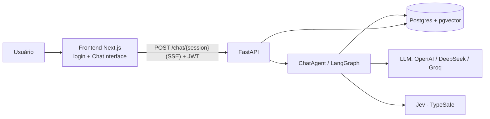
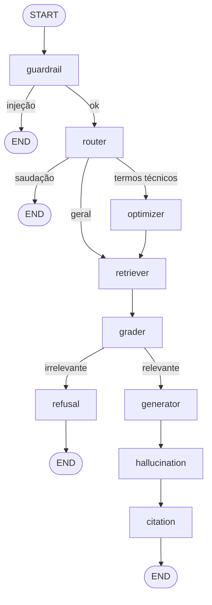

# Documentação do Sistema — jupiterclass-chat

Chatbot **RAG** (Retrieval-Augmented Generation) de **metodologia científica e normas ABNT/APA**, extraído do sistema JupiterClass como serviço independente. O assistente atua como um "Professor Doutor em Metodologia Científica" que responde dúvidas sobre TCC, artigos e monografias com base em uma base de conhecimento própria (manuais do IFCE, resoluções do CNS, ABNT etc.).

---

## 1. Visão geral

| Camada | Tecnologia | Pasta |
|---|---|---|
| Frontend | Next.js 14 (App Router), React 18, TypeScript, Tailwind CSS | `frontend/` |
| Backend | FastAPI (Python 3.11), LangGraph, LangChain | `backend/` |
| Banco | PostgreSQL 16 + extensão `pgvector` | `backend/migrations/` |
| LLMs | OpenAI (padrão), DeepSeek ou Groq; validador OpenAI | `backend/adapters/` |
| Julgamento tipado | Jev (TypeSafe SDK) | `backend/adapters/typesafe_adapter.py` |
| Deploy | Docker / Docker Compose / Railway | `docker-compose.yml`, `railway.json` |



---

## 2. Arquitetura (hexagonal)

O backend segue **arquitetura hexagonal (ports & adapters)**. A regra de dependência é: `core/` → `ports/` ← `adapters/`. O core **nunca** importa adapters nem SDKs de fornecedores.

```
backend/
├── main.py               # cria o app FastAPI, CORS, inclui routers
├── api/
│   ├── container.py      # Composition root: único lugar que escolhe implementações
│   ├── auth.py           # validação/emissão de JWT (HS256)
│   └── routers/          # chat, auth, project, system
├── core/
│   ├── chat_agent.py     # orquestra o grafo e persiste mensagens
│   ├── langgraph_flow.py # nós e arestas do pipeline RAG
│   ├── state.py          # AgentState (TypedDict)
│   ├── prompts.py        # prompts de router/grader/guardrail etc.
│   ├── observability.py  # tracking de tokens, custo e latência
│   ├── project_knowledge.json
│   └── application/      # auth_service, jev_judgments, project_knowledge
├── ports/                # interfaces abstratas (ABC)
├── adapters/             # implementações concretas
├── ingest/               # scripts de ingestão da base de conhecimento
├── knowledge/            # PDFs e markdowns fonte
├── migrations/001_init.sql
└── tests/
```

### Ports e adapters

| Port | Responsabilidade | Adapter(s) |
|---|---|---|
| `VectorRepositoryPort` | busca semântica / upsert / delete de chunks | `PgVectorAdapter` |
| `ChatRepositoryPort` | histórico, feedback, posse de sessões | `PostgresChatAdapter` |
| `UserRepositoryPort` | usuários (cadastro/login) | `PostgresUserAdapter` |
| `UsageLogPort` | registro de uso de LLM (tokens, custo) | `PostgresUsageAdapter` |
| `JudgePort` | perguntas sim/não → probabilidade | `TypeSafeAdapter` (Jev) |
| *(provedor LLM)* | `chat()` com streaming, embeddings | `OpenAIAdapter`, `DeepSeekAdapter`, `GroqAdapter` |

O teste `tests/test_architecture.py` **garante** que `core/` não importa `adapters` nem `typesafe_sdk`.

### Composition root — `api/container.py`
- Carrega o `.env` **antes** de importar adapters (alguns leem variáveis no nível do módulo).
- Escolhe o LLM principal via `LLM_PROVIDER` (`openai` | `deepseek` | `groq`).
- Cria um `_validator_llm` (OpenAI, `VALIDATOR_MODEL`) usado como plano B de validação.
- Monta `PgVectorAdapter`, `PostgresChatAdapter`, `PostgresUserAdapter`, `AuthService`.
- `get_chat_agent()` injeta tudo no `ChatAgent`; `get_typesafe_adapter()` e `get_project_knowledge_service()` são criados sob demanda (`lru_cache`).

---

## 3. Pipeline RAG (LangGraph)

Definido em [langgraph_flow.py](backend/core/langgraph_flow.py) (`build_agent_graph`). O estado (`AgentState`) carrega a mensagem, documentos recuperados, flags (`is_injection`, `is_relevant`, `is_hallucination`, `is_greeting`) e as dependências injetadas (`_vector_repository`, `_llm_provider`, `_validator_llm`, `_judge`, `_chat_repository`).



### Nós

1. **Guardrail** — detecta prompt injection. Primeiro uma regex de palavra inteira (`ignore`, `forget`, `bypass`, `pirate`, `system prompt`, `dan`); depois o **Jev** (`injection_probability`, limiar 0,5); se o Jev não estiver configurado, usa o LLM validador (`GUARDRAIL_PROMPT`). Em caso de injeção responde com recusa e encerra.
2. **Router** — saudações/agradecimentos recebem resposta pronta amigável (sem retrieval). Mensagens com palavras técnicas/acadêmicas (`abnt`, `tcc`, `metodologia`, `lattes`…) vão para o optimizer; demais vão direto ao retriever.
3. **Optimizer** — reescreve a consulta com prefixo `academic research query:`.
4. **Retriever** — `search_similar_chunks(query, limit=5, threshold=0.5)` no pgvector.
5. **Grader** (Self-RAG) — o Jev atribui relevância a cada documento (`RELEVANCE_THRESHOLD = 0.5`); descarta os irrelevantes. Sem Jev, mantém todos.
6. **Refusal** — se nenhum documento é relevante, responde que não há evidências suficientes na base.
7. **Generator** — monta o *system prompt* do "Professor de Metodologia" (usa `skills/promptProfessor.md` se existir, senão um prompt embutido), restringe o escopo a metodologia/ABNT/APA, injeta até 2000 caracteres de contexto e **personaliza com feedback** (última resposta curtida/não curtida do histórico). Chama o LLM em streaming (`max_tokens=500`, `temperature=0`).
8. **Hallucination checker** — o Jev avalia se a resposta está fundamentada (`GROUNDED_THRESHOLD = 0.5`); se não, acrescenta um aviso. Plano B: LLM validador.
9. **Citation** — formata as fontes como referências **ABNT NBR 6023** e as anexa à resposta (`### 📚 Referências`).

### Jev (TypeSafe) como julgador
O Jev devolve **julgamentos tipados** (probabilidade de "sim"), não texto livre: o código decide o fluxo, o Jev dá o julgamento semântico. A aplicação só conhece `JudgePort`/`YesNoQuestion`; perguntas independentes sobre o mesmo estado vão agrupadas numa única chamada. As funções ficam em [jev_judgments.py](backend/core/application/jev_judgments.py) (`grade_documents`, `grounded_probability`, `injection_probability`) e retornam `None` quando o Jev está indisponível, acionando o plano B.

### ChatAgent e streaming
[chat_agent.py](backend/core/chat_agent.py) executa o grafo (`ainvoke`), emite eventos SSE (`status`, `token`, `error`) — a resposta final é fatiada em blocos de 20 caracteres — e persiste a mensagem do usuário e a do assistente (com `processing_time_ms`, `rag_version`, `model_version`).

---

## 4. Banco de dados

Schema idempotente em [001_init.sql](backend/migrations/001_init.sql):

| Tabela | Conteúdo |
|---|---|
| `knowledge_documents` | documentos-fonte (título, URL) |
| `document_chunks` | trechos + `embedding VECTOR(1536)` + `metadata JSONB`; índice **HNSW** (cosseno) |
| `chat_sessions` | sessões (`user_id` = dono) |
| `chat_messages` | mensagens (`role`, `content`, `feedback`, `processing_time_ms`, `rag_version`, `model_version`) |
| `chat_users` | `nome`, `email` único, `senha_hash` |
| *(criada pelo adapter)* usage log | provider, modelo, tokens, custo, latência, endpoint |

---

## 5. API

| Método | Rota | Descrição | Auth |
|---|---|---|---|
| POST | `/api/auth/register` | cadastro; devolve JWT + usuário | — |
| POST | `/api/auth/login` | login; devolve JWT + usuário | — |
| GET | `/api/auth/me` | dados do usuário logado | Bearer |
| POST | `/chat/{session_id}` | mensagem → resposta via **SSE** | Bearer |
| POST | `/chat/message/{message_id}/feedback` | `like` / `dislike` / `null` | Bearer |
| POST | `/api/project/ask` | perguntas sobre o projeto (via Jev + `project_knowledge.json`) | Bearer |
| GET | `/health` | status, modelo, modelos disponíveis | — |
| GET | `/` | mensagem raiz | — |

**Formato SSE** (`data: {json}\n\n`): `{"type":"status","status":"...","node":"..."}`, `{"type":"token","content":"..."}`, `{"type":"error","error":"..."}`.

### Autenticação e autorização
- Cadastro/login próprios; senha com **scrypt** (`n=2^14, r=8, p=1`, salt aleatório, comparação `hmac.compare_digest`); senha mínima de 8 caracteres.
- **JWT HS256** com claims `sub` e `exp` (TTL padrão 8 h, `CHAT_TOKEN_TTL_SECONDS`), assinado com `CHAT_JWT_SECRET`.
- Tokens emitidos pelo sistema principal também valem (mesmo segredo).
- `CHAT_AUTH_REQUIRED=false` desliga a auth (**somente dev**).
- **Posse de recursos**: a sessão pertence a quem a criou (`claim_session`); outro usuário recebe 403. O mesmo vale para feedback de mensagens. Sessões antigas sem dono (`user_id` nulo) não aparecem para ninguém.
- CORS: `localhost`, `*.railway.app` e origens extras em `ALLOWED_ORIGINS`.

---

## 6. Observabilidade

[observability.py](backend/core/observability.py) fornece o decorator `track_llm_usage`, aplicado nos métodos dos adapters de LLM: conta tokens (`tiktoken`), calcula custo por tabela `COSTS` (USD / 1M tokens, por provedor e modelo) e grava latência, via `UsageLogPort`. Suporta chamadas com e sem streaming. O `PostgresUsageAdapter` também oferece resumos por período, provedor e usuário.

---

## 7. Frontend

Next.js 14 (App Router) em `frontend/`, porta de dev **3001**.

- [`app/page.tsx`](frontend/app/page.tsx) — `ChatWidget`: se não há token, mostra `AuthForm`; com token, mostra `ChatInterface`. O token fica em `sessionStorage` e também pode vir pelo fragmento `#token=` da URL ou por `postMessage` (`{type:"chat-token", token}`), validando `NEXT_PUBLIC_PARENT_ORIGIN`. Projetado para uso em **iframe** no sistema principal.
- `components/auth/AuthForm.tsx` — login e cadastro.
- `components/chat/` — `ChatInterface` (consome o SSE, controle de tamanho de fonte de 85% a 150%, curtir/descurtir, copiar, colar no input), `MessageList`, `MessageInput`, `FormattedResponse` (renderização Markdown), `TypewriterText`, `StatusBadge`.
- Variável: `NEXT_PUBLIC_API_URL` (padrão `http://127.0.0.1:8000`).
- Em caso de HTTP 401, `onUnauthorized` limpa o token e volta ao login.

---

## 8. Base de conhecimento (ingestão)

Scripts em `backend/ingest/`: `ingest_pdf.py`, `ingest_docx.py`, `ingest_latex.py`, `ingest_markdown.py`, `ingest_all_models.py`. Eles dividem os documentos em chunks (LangChain text splitters), geram embeddings (`text-embedding-3-small`, 1536 dimensões) e gravam em `document_chunks`.

Fontes em `backend/knowledge/`: Manual de Normalização do IFCE, Metodologia de Pesquisa para Ciência da Computação (Wazlawick), Resoluções CNS 466/2012 e 510/2016 (ética em pesquisa), Tabela de Áreas do CNPq, guia de normas ABNT. Também há modelos do IFCE (`.docx`, `.odt`, template LaTeX `ifcetex2`).

Em produção: `scripts/popular_base_conhecimento_producao.sh` (não validado após a extração).

`core/project_knowledge.json` é um retrato estático do sistema original usado por `/api/project/ask`; o gerador não veio junto na extração.

---

## 9. Configuração (variáveis de ambiente)

Veja `backend/.env.example`.

| Variável | Uso |
|---|---|
| `DATABASE_URL` | conexão Postgres (ou `POSTGRES_*`) |
| `OPENAI_API_KEY`, `OPENAI_MODEL` (`gpt-4o-mini`) | LLM padrão e embeddings |
| `OPENAI_EMBEDDING_MODEL` / `OPENAI_EMBEDDING_DIM` | `text-embedding-3-small` / `1536` |
| `LLM_PROVIDER` | `openai` \| `deepseek` \| `groq` |
| `DEEPSEEK_API_KEY/MODEL/BASE_URL`, `GROQ_API_KEY/MODEL` | provedores alternativos |
| `VALIDATOR_MODEL` | LLM validador (plano B) |
| `TYPESAFE_API_KEY`, `TYPESAFE_MODEL` (`jev-latest`) | Jev |
| `CHAT_JWT_SECRET` | segredo JWT (mín. 32 caracteres) |
| `CHAT_AUTH_REQUIRED` | `true` por padrão |
| `CHAT_TOKEN_TTL_SECONDS` | validade do token |
| `ALLOWED_ORIGINS` | CORS extra |

---

## 10. Execução local

```bash
docker compose up db -d                # Postgres + pgvector (aplica backend/migrations)
cd backend && python3.11 -m venv .venv && .venv/bin/pip install -r requirements.txt
cp .env.example .env                   # preencher chaves
.venv/bin/uvicorn main:app --reload    # API em :8000 (docs em /docs)
cd ../frontend && npm install && npm run dev   # http://localhost:3001
cd ../backend && .venv/bin/python -m pytest    # testes
```

O `docker-compose.yml` sobe `db` (`pgvector/pgvector:pg16`, usuário/banco `rag_db`) e `backend` (build do Dockerfile, porta 8000).

---

## 11. Deploy

- **Backend** (`Dockerfile`, Python 3.11-slim): instala dependências, `HEALTHCHECK` em `/health`, e executa `railway-start.sh`, que (1) aguarda o banco (até 30 tentativas), (2) aplica as migrations `migrations/*.sql` (idempotentes) e (3) inicia `uvicorn main:app` na `$PORT`.
- **Frontend**: Railway com NIXPACKS (`npm run build` / `npm run start`, política de restart `ALWAYS`).

---

## 12. Testes

`backend/tests/` (pytest): `test_architecture` (regra de dependência e adapter do Jev), `test_auth`, `test_auth_service`, `test_chat_slice`, `test_chat_ownership`, `test_observability`. Frontend: `npm run typecheck`.

---

## 13. Como foi construído

1. **Extração**: o chat foi separado do sistema JupiterClass (repositório `chatbot`, commit `fbe40d5`) em um serviço independente, copiado sem histórico git. Schema reduzido a `init.sql` + colunas adicionadas depois, consolidado em `001_init.sql`.
2. **Arquitetura hexagonal**: o acoplamento a fornecedores foi isolado em `ports/` + `adapters/`, com um *composition root* único e um teste automatizado que impede regressões (lista de débitos `KNOWN_DEBT` vazia).
3. **Pipeline agentic com LangGraph**: fluxo Self-RAG (guardrail → roteamento → recuperação → avaliação de relevância → geração → checagem de alucinação → citação ABNT).
4. **Julgamentos com Jev**: substituíram chamadas de LLM "texto livre" para decisões sim/não por probabilidades tipadas e limiares explícitos, mantendo o LLM validador como plano B.
5. **Autenticação própria**: cadastro/login com scrypt + JWT, posse de sessões e mensagens, compatível com tokens do sistema principal para uso em iframe.
6. **Observabilidade de custos** para todos os provedores de LLM.
7. **Frontend** Next.js leve, com streaming SSE, feedback do usuário (que realimenta o prompt) e acessibilidade (ajuste de fonte).

---

## 14. Limitações e pendências conhecidas

- `scripts/migrar_dados.sh` (copia base de conhecimento e histórico do Postgres antigo; somente leitura na origem, destino deve estar vazio, confere contagens) **ainda não foi executado**; conversas antigas ficam sem dono.
- Script de produção de popular a base não foi validado após a extração.
- `project_knowledge.json` é estático (sem gerador).
- O streaming é simulado: o grafo roda por completo e a resposta final é enviada em blocos de 20 caracteres.
- O Optimizer apenas prefixa a consulta (não usa LLM) e o roteamento é heurístico por palavras-chave.
